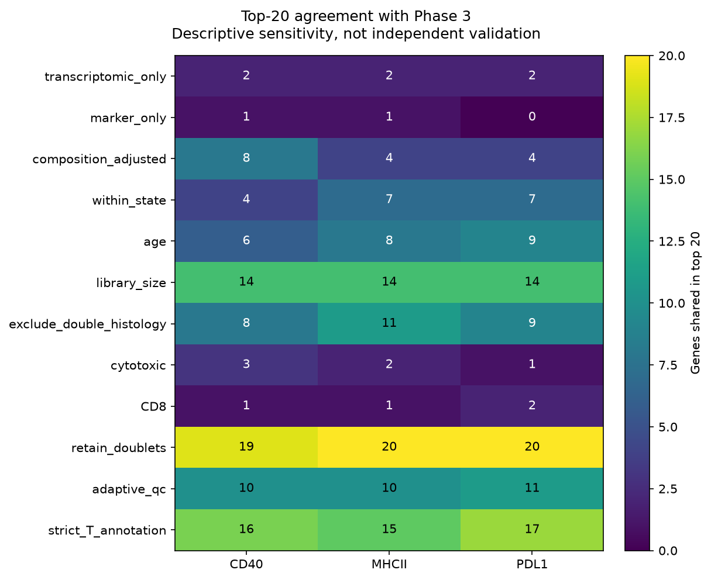
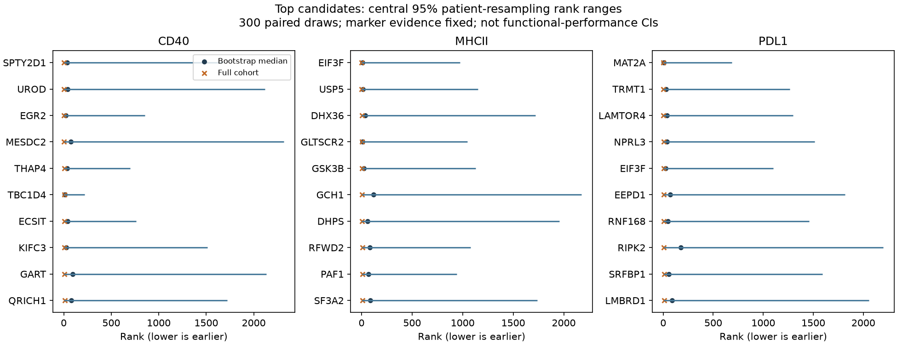

# Phase 4 benchmark and robustness

**Decision: INCONCLUSIVE.** Independent functional performance cannot be estimated from the current inventory.

The audit found one quantitative development family and zero eligible independent quantitative T-cell-function outcomes. No AUPRC, precision@20, held-out rank correlation or performance confidence interval is reported. Missing metrics are not zero performance. Neither superiority nor failure to improve is established.

## Completed analyses
Frozen universe: 6,124 genes, 11 patients, 5,155 mapped candidates per marker. Completed 300 paired patient bootstrap draws, 11 leave-one-patient-out refits, 15 ablation/sensitivity comparisons per marker, source/partition checks and provenance verification. All three mouse marker endpoints stay separate.

## Leave-one-patient-out stability
| Marker | Spearman range | Shared top-20 range |
|---|---:|---:|
| CD40 | 0.773–0.980 | 10–17 |
| MHCII | 0.778–0.981 | 9–16 |
| PDL1 | 0.776–0.980 | 11–15 |

The top lists change materially when individual patients are omitted. For the leading full-data candidate in each marker stratum, top-20 membership across patient-bootstrap draws was:
- CD40: SPTY2D1, 39.7%; central rank range 1.0–1674.8.
- MHCII: EIF3F, 64.0%; central rank range 1.0–974.9.
- PDL1: MAT2A, 72.0%; central rank range 1.0–686.0.

## Ablation and sensitivity findings
| Marker | Comparison | Common genes | Shared top 20 | Rank correlation |
|---|---|---:|---:|---:|
| CD40 | transcriptomic_only | 5155 | 2 | 0.687 |
| CD40 | marker_only | 5155 | 1 | 0.687 |
| CD40 | composition_adjusted | 5155 | 8 | 0.627 |
| CD40 | within_state | 5155 | 4 | 0.679 |
| CD40 | exclude_indirect | 0 | not estimable | not estimable |
| CD40 | leave_development_family_out | 0 | not estimable | not estimable |
| CD40 | CD8 | 5155 | 1 | 0.549 |
| CD40 | adaptive_qc | 5155 | 10 | 0.899 |
| CD40 | age | 5155 | 6 | 0.731 |
| CD40 | cytotoxic | 5155 | 3 | 0.608 |
| CD40 | exclude_double_histology | 5155 | 8 | 0.692 |
| CD40 | library_size | 5155 | 14 | 0.875 |
| CD40 | retain_doublets | 5155 | 19 | 1.000 |
| CD40 | sex | 0 | not estimable | not estimable |
| CD40 | strict_T_annotation | 5155 | 16 | 0.974 |
| MHCII | transcriptomic_only | 5155 | 2 | 0.691 |
| MHCII | marker_only | 5155 | 1 | 0.691 |
| MHCII | composition_adjusted | 5155 | 4 | 0.631 |
| MHCII | within_state | 5155 | 7 | 0.675 |
| MHCII | exclude_indirect | 0 | not estimable | not estimable |
| MHCII | leave_development_family_out | 0 | not estimable | not estimable |
| MHCII | CD8 | 5155 | 1 | 0.545 |
| MHCII | adaptive_qc | 5155 | 10 | 0.900 |
| MHCII | age | 5155 | 8 | 0.737 |
| MHCII | cytotoxic | 5155 | 2 | 0.611 |
| MHCII | exclude_double_histology | 5155 | 11 | 0.695 |
| MHCII | library_size | 5155 | 14 | 0.875 |
| MHCII | retain_doublets | 5155 | 20 | 1.000 |
| MHCII | sex | 0 | not estimable | not estimable |
| MHCII | strict_T_annotation | 5155 | 15 | 0.974 |
| PDL1 | transcriptomic_only | 5155 | 2 | 0.689 |
| PDL1 | marker_only | 5155 | 0 | 0.691 |
| PDL1 | composition_adjusted | 5155 | 4 | 0.630 |
| PDL1 | within_state | 5155 | 7 | 0.676 |
| PDL1 | exclude_indirect | 0 | not estimable | not estimable |
| PDL1 | leave_development_family_out | 0 | not estimable | not estimable |
| PDL1 | CD8 | 5155 | 2 | 0.544 |
| PDL1 | adaptive_qc | 5155 | 11 | 0.902 |
| PDL1 | age | 5155 | 9 | 0.737 |
| PDL1 | cytotoxic | 5155 | 1 | 0.608 |
| PDL1 | exclude_double_histology | 5155 | 9 | 0.696 |
| PDL1 | library_size | 5155 | 14 | 0.873 |
| PDL1 | retain_doublets | 5155 | 20 | 1.000 |
| PDL1 | sex | 0 | not estimable | not estimable |
| PDL1 | strict_T_annotation | 5155 | 17 | 0.975 |

## Patient-resampling uncertainty and failure cases
Per-gene effect and rank quantiles, valid-draw counts, top-20 selection frequencies and patient omissions are exported. Central 95% resampling ranges are descriptive stability summaries with only 11 patients, not calibrated CIs. They condition on the selected genes, fixed mouse assays, orthology and source annotation. They do not cover functional-study uncertainty.
Failure-case tables retain all reference top-20 genes and the largest leave-one-patient-out rank changes. A high full-data rank need not mean stable prioritization. Removing indirect evidence or the sole development family eliminates integrated ranking; the sex-adjusted model is unestimable. Cytotoxic/CD8 comparisons change the endpoint and are not replication.

## Limits and reopening requirements
Only one human transcriptomic cohort is available, so cohort transfer cannot be assessed. No valid differential-expression contrast or compatible independent ligand-method benchmark was specified. No gene split, marker proxy, selected qualitative follow-up or same-study cross-marker comparison replaces an independent functional endpoint. New compatible quantitative T-cell-function studies with biological units, stable mappings and previously unseen study families are required; freeze a new evaluation protocol before inspecting outcomes.

## Reproduce
`python phase4.py`; `python -m pytest tests -q`; `python build_phase4_notebook.py`; `python verify_phase4.py`. See phase4_protocol.md, leakage_audit.md, configs/phase4.json and results/phase4_manifest.json.

