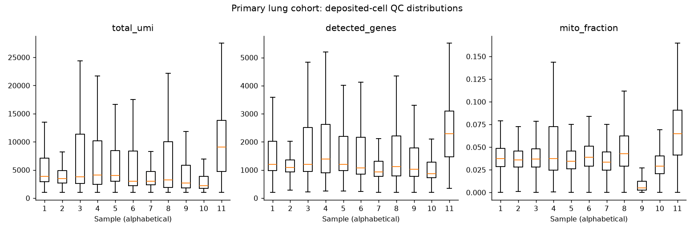
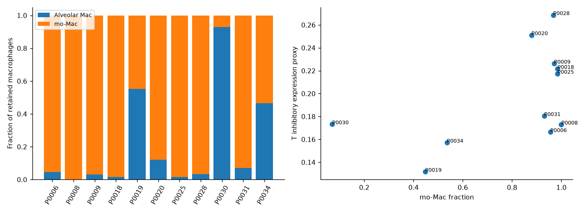
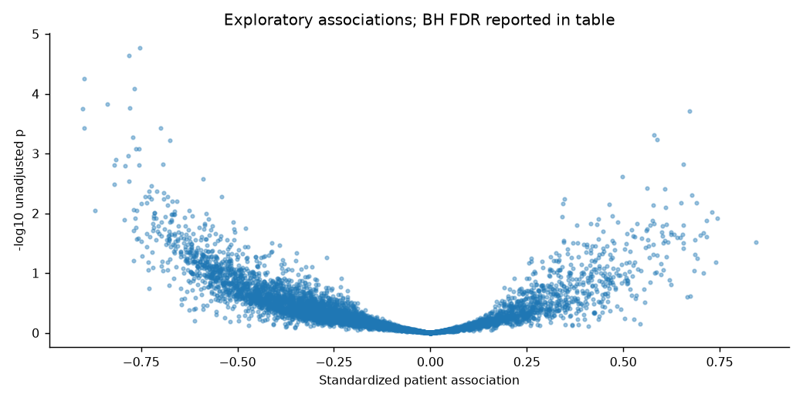
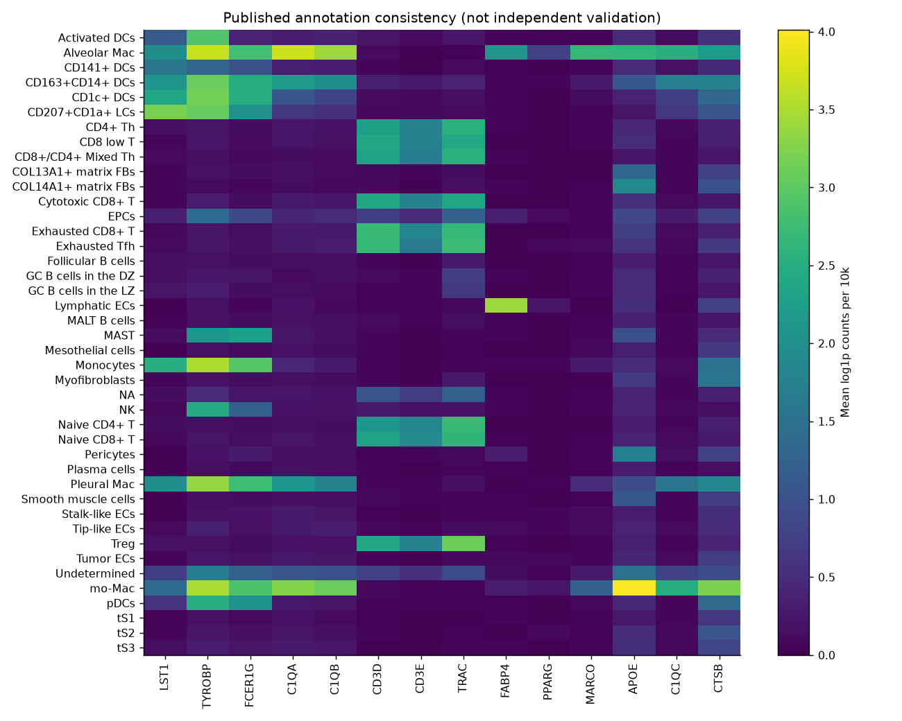

# Descriptive transcriptomic baseline

Analyzed 11 primary lung-tumor patients; 45,149 deposited cells, 44,984 retained after QC/doublet assessment; 6,124 eligible macrophage genes.

Primary BH FDR <0.05: **0 genes**. Composition-adjusted BH FDR <0.05: **1 gene**.

## Interpretation
These are exploratory patient-level expression associations, not measured immune suppression, gene causality, target validation or predictive performance. Small patient count limits power and covariate adjustment. Candidate order reflects statistical evidence only; functional outcomes were not used.

## Leading unadjusted associations
| Gene | Effect | p | FDR | Composition-adjusted effect | LOO sign fraction |
|---|---:|---:|---:|---:|---:|
| GLTSCR2 | -0.754 | 1.7e-05 | 0.0694 | -0.648 | 1.00 |
| ARL6IP4 | -0.782 | 2.27e-05 | 0.0694 | -0.787 | 1.00 |
| PTMS | -0.897 | 5.6e-05 | 0.114 | -1.033 | 1.00 |
| C6orf48 | -0.767 | 8.29e-05 | 0.127 | -0.663 | 1.00 |
| ADPRH | -0.837 | 0.000151 | 0.15 | -0.745 | 1.00 |
| OXR1 | -0.779 | 0.000171 | 0.15 | -0.677 | 1.00 |
| HTRA2 | -0.901 | 0.000181 | 0.15 | -0.821 | 1.00 |
| LIMS1 | 0.671 | 0.000196 | 0.15 | 0.544 | 1.00 |
| TRMT2A | -0.700 | 0.000372 | 0.23 | -0.586 | 1.00 |
| USP32 | -0.897 | 0.000375 | 0.23 | -0.844 | 1.00 |

## Methods and reproducibility
See phase2_protocol.md and configs/phase2.json for prespecified signatures, QC, candidate filters, denominator and inference. Run `python phase2.py` from the project. Counts are streamed into a sparse primary-lung cache. The complete deposited matrix is parsed and gzip integrity checked during ingestion. Sample/patient mapping uses the source workbook. results/run_manifest.json records hashes, software and configuration.

## Limitations
Published cell labels are retained and marker consistency is inspected on the same data; this is not independent validation. Source preprocessing and prior filtering cannot be undone. Scrublet is a probabilistic screen with assumed 5% rate, not verified doublet truth. Patient and capture batch are confounded; no study integration is applied. Separate age/sex/library-size sensitivity models avoid a highly parameterized model. All-T-cell scores include subtype-composition variation; CD8-restricted and cytotoxic sensitivities are separate. Missing genes are reported in signature coverage; unresolved stable IDs stay blank. Single cohort cannot establish generalization.

## Outputs
Candidate table, nine sensitivity analyses, leave-one-patient-out effects, per-patient expression/features, cell QC and doublet calls, marker diagnostics, composition decomposition and four figures are in results/. Primary and QC-annotated sparse count files are in data/curated/.

## Figures

## Run-specific QC and sensitivity findings
- Source QC retained 45,149/45,149 cells; Scrublet flagged 165 cells across the included captures.
- Final macrophages per patient: 141–1146; T cells: 310–3582.
- Standardized within-state models use 10 patients with both states. Missing states are not assigned zero expression.
- Unique HGNC IDs mapped: 5730/6124; source symbols retained for all genes.

| Sensitivity | Patients | Estimable genes | FDR < .05 | Effect rank correlation with primary |
|---|---:|---:|---:|---:|
| CD8 | 11 | 6124 | 4 | 0.553 |
| adaptive_qc | 11 | 6124 | 0 | 0.936 |
| age | 11 | 6124 | 0 | 0.826 |
| cytotoxic | 11 | 6124 | 0 | 0.592 |
| exclude_double_histology | 9 | 6124 | 0 | 0.798 |
| library_size | 11 | 6124 | 0 | 0.951 |
| retain_doublets | 11 | 6124 | 0 | 1.000 |
| sex | 11 | 0 | 0 | nan |
| strict_T_annotation | 11 | 6124 | 0 | 0.987 |

The sex-adjusted HC3 model is not estimable if the single female patient has leverage one; such results are missing, not negative findings. Cytotoxicity is a different endpoint, so low correlation there is not itself a failed robustness test. All sensitivity FDR families are separate and exploratory. Large shifts under QC/composition changes indicate fragility, not evidence favoring the most significant variant.

## Annotation and missing-state checks
Published broad T labels include unresolved and NK subtype labels; strict_T_annotation excludes them. CD8 sensitivity requires at least 20 retained cells per patient. Alveolar macrophages are absent for one source sample and sparse in others; within-state summaries may be noisy even when defined. Marker heatmaps are consistency checks on the source labels only.

## Secondary composition-adjusted findings
C3AR1: composition-adjusted FDR 0.000968302, primary FDR 0.999966. This model-dependent association is exploratory and is not independent validation or evidence of causality.